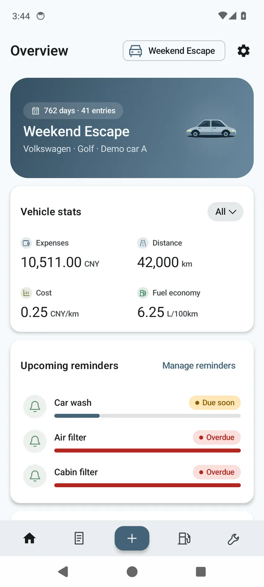
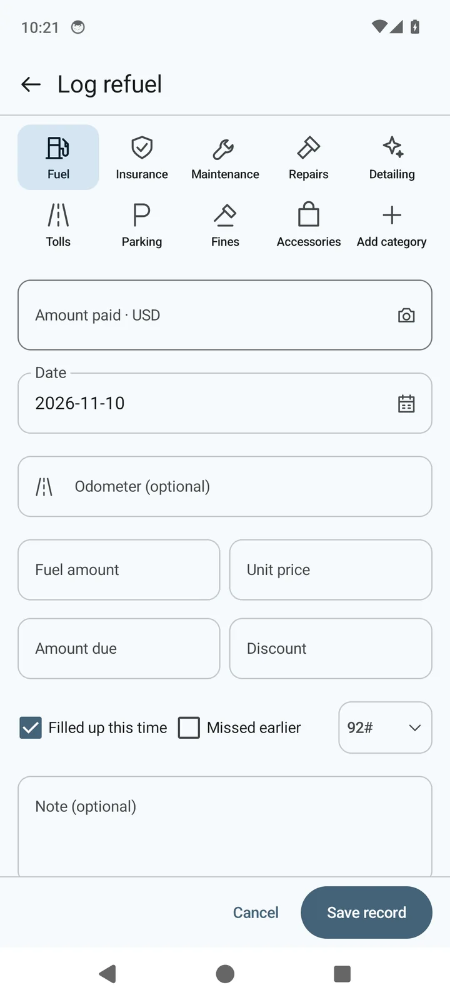
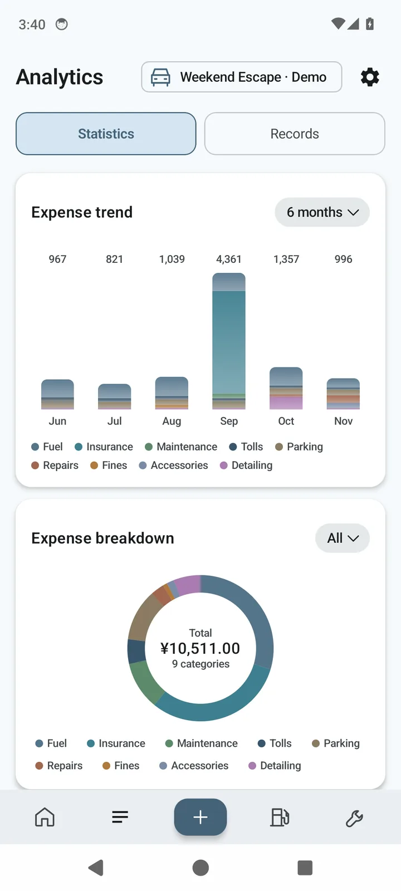
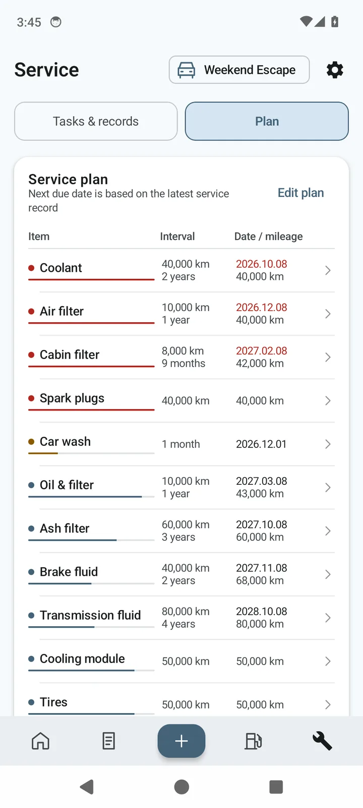

# MileNote


[简体中文](README.md) · **English**

MileNote is an **open-source, native, local-first Android app for logging car expenses and mileage**. It supports multiple vehicles, daily expense records, fuel and energy analysis, service planning and running-cost statistics.

No account is needed, and the ledger is stored on your phone by default — it never depends on a developer server. To sync between devices, you can connect your own WebDAV storage and optionally enable encrypted upload (off by default).

Refuelling, charging, parking, insurance, repairs and scheduled maintenance all live in one place, with charts that show how each car is used and where the money goes over time.

[**Website & download**](https://selwiro.github.io/MileNoteAndroid/en/) · [Issues](https://github.com/Selwiro/MileNoteAndroid/issues)

## Highlights

- **Local-first, no account:** the ledger stays on your device by default, with no subscriptions, ads or analytics.
- **Fuel cars, plug-in hybrids and EVs:** fuel-economy, dual fuel + energy analysis, or energy analysis, each with a matching service plan.
- **Independent multi-vehicle management:** expenses, energy and service records are kept per vehicle; a full backup covers every vehicle.
- **Customisable categories and item library:** built-in expense categories and service items can be renamed or hidden (Fuel/Insurance/Service/Repair cannot be deleted); hiding only affects new-entry candidates, never existing records or statistics.
- **Easy migration:** import records from Bear and Qianji; the expense CSV can be exported, edited and imported back (records update in place by ID), with full JSON backups and optional WebDAV sync (encrypted upload supported).

## Screenshots

These screenshots come from an older build's demo ledger (English UI); all data is synthetic. **Since 0.39.0 the bottom bar is Overview / Fuel / ＋ / Service / Me** (the Analytics page was dissolved: expense trend moved to Overview, expense details open from the Overview top-right icon; fuel details and maintenance records open from their page top-right icons). The interface keeps evolving — see the [website](https://selwiro.github.io/MileNoteAndroid/en/#screenshots) for the latest screens.

| Overview | Add entry | Analytics | Service |
|:---:|:---:|:---:|:---:|
|  |  |  |  |

## Features

### Daily logging and multi-vehicle management

MileNote supports any number of vehicles and keeps expenses, energy and service records separate for each one. A vehicle can have a name and a photo; photos can be picked from the gallery and are compressed automatically, or added through an image URL.

Nine expense categories are built in:

| Category | Typical records |
|---|---|
| Fuel | Refuelling and charging |
| Insurance | Compulsory and commercial insurance |
| Maintenance | Routine servicing and consumables |
| Repairs | Fault diagnosis and parts repair |
| Detailing | Car wash, cleaning and detailing |
| Tolls | Motorways and toll roads |
| Parking | Short-term and car-park fees |
| Fines | Traffic-related penalties |
| Car supplies | In-car devices, accessories and supplies |

You can also create custom categories as needed.

The entry page keeps category, amount, date, mileage and energy fields on one screen, so you don't have to keep switching. Existing records support search, filtering, a month view, editing and deletion.

### Fuel economy and energy consumption

MileNote records and analyses energy differently depending on the vehicle's powertrain.

**Fuel cars: full-tank method**

Fuel economy is calculated from the distance and the actual fuel volume between two full tanks, so incomplete intervals never skew the average.

- The first full tank only establishes a baseline.
- Partial fills accumulate until the next settlement.
- If a refuel was missed, mark it as missed and rebuild the baseline.
- Outputs include average fuel economy, fuel cost per kilometre and trends; fill-up / charging details open from the page top-right icon.

**Plug-in hybrids / range extenders: dual fuel and energy**

Plug-in hybrids record both refuelling and charging: pick "Charge" in the fuel-grade dropdown when adding an entry and the fields switch to charge amount, price and full charge.
Energy analysis reports **L/100 km and kWh/100 km** as two separate figures, plus a shared cost per kilometre.
Both figures use total mileage as the denominator (including distance driven on the other energy source), so they read lower than charge-depleted fuel economy — that is the definition, not a calculation error.

**EVs: full-charge method**

EVs use charging records for energy analysis, showing average energy economy in **kWh/100 km**, plus charging spend and cost per kilometre.

Full-charge intervals are preferred. If the selected range has no usable full-charge interval, the app estimates from cumulative charging and labels the method in the interface.

All analysis is based on recorded data; the app never invents missing records.

### Service plans

The app ships with preset service plans for each powertrain:

- Fuel cars: 12 default service items.
- Plug-in hybrids / range extenders: 13 items (the 12 fuel items plus an EV system check); the first service includes oil & filter and the EV system check.
- EVs: 6 default service items.

Reminders consider both time and mileage, and **whichever threshold is reached first marks the item as due**.

The plan table shows what was last completed, the next expected date and mileage, and the current status. After you complete a service and save the record, the app schedules the next round automatically.

Due items appear in the in-app to-do list (since 0.39.0 to-dos and the plan share one page: to-dos show only overdue + the next 3–5 items, while the plan table keeps the full schedule). To use system calendar reminders, export a single plan as an `.ics` file; past maintenance records open from the Service page top-right icon and can be filtered by Repair / Service / Detailing.

### Spending statistics and expense details

**Since 0.39.0** the standalone Analytics page is gone; statistics and the record list live in two places:

- **Overview**: vehicle stats (total spend, recorded mileage, cost per kilometre, average fuel economy — all following the selected range), mileage trend, and expense trend (stacked monthly bars showing how each category changes).
- **Expense details**: open from the Overview top-right icon; search plus time (all / this month / this year / custom) and category filters, "N records / filtered total", grouped by month, with edit and delete.
- The expense breakdown donut is temporarily retired with the old Analytics page and is planned for the upcoming monthly / annual report feature.

Cost per kilometre is based on recorded spending and recorded mileage. Unrecorded costs such as depreciation or loan interest are not included automatically.

### Receipt scanning

After refuelling, pick a receipt or pump-display photo with the system photo picker.

The app uses **Tesseract** (Tesseract4Android, with the tessdata_fast Chinese and English models bundled) to recognise receipts on the device and tries to extract the amount paid, fuel volume and date. It does not request camera access and does not take photos.

Pump-display screens (seven-segment LED/LCD) use a **built-in geometric decoder** instead: it reads the amount, fuel volume and unit price directly from the segment positions and still validates them with `amount ≈ fuel × unit price`. If nothing can be read, tap **Fill in / edit the readings** on the result panel to enter them quickly with a numeric keypad or the numbers found in the recognised text.

Scan results only fill fields that are still empty and never overwrite existing values. Review them before saving so a misread doesn't end up in your ledger.

Recognition runs locally; the image is never uploaded and never written into the ledger.

### Import and export

If you already tracked expenses in another app, you don't have to start from scratch.

Supported sources:

| Source | Import formats |
|---|---|
| MileNote CSV (write-back) | CSV |
| Bear | XLS |
| Qianji | XLSX, JSON |
| MileNote full backup | JSON |

While importing you can adjust field mapping, preview and edit records row by row, and skip detected duplicates. You can also send a file to MileNote through the Android share sheet.

Export comes in two forms:

- **Expense CSV:** the current vehicle's expense details — 18 columns for fuel/EV, 19 for plug-in hybrid; the trailing "record ID" column is the write-back anchor, so an edited CSV re-imports and updates records in place without duplicates. The app also warns in Me and Backup & restore after 30 days without a backup.
- **Full JSON backup:** every vehicle, record, service entry and related data.

A full backup works for switching phones, restoring data, or keeping as a standalone local archive.

### WebDAV sync

WebDAV is optional. Without it, the ledger always stays local.

You can connect Nutstore (Jianguoyun), Nextcloud, Synology NAS or any other WebDAV-compatible storage service.

Sync can be triggered manually, runs once when the app opens, and is debounced after local edits.

Sync jobs only run while the app is in the foreground; they stop when you leave the app.

The WebDAV password is encrypted with Android Keystore and AES-256-GCM before being stored on the device. Release builds only allow HTTPS connections.

The uploaded ledger can optionally be encrypted; this is off by default. Turn on **Encrypted upload** under Settings → WebDAV sync and set a separate encryption password (at least 8 characters), and the remote file is stored as AES-256-GCM ciphertext whose key is derived from that password with PBKDF2-SHA256 (600,000 iterations). The encryption password is also protected by the Android Keystore and kept only on this device; the developer cannot access it. On another device, enter the same password to decrypt and restore the ledger.

Encrypted files use the same format as the Web version's "encrypted sync", so the two are interoperable: the Web version can read files encrypted by the Android app, and the Android app can read the Web version's encrypted or plain files.

**Note:** without encryption, the uploaded ledger remains plain JSON and transport security relies on HTTPS; use a service you trust and set access permissions carefully. The encryption password cannot be recovered — if you forget it, the remote encrypted ledger cannot be decrypted. Please remember it.

### Other features

| Feature | Description |
|---|---|
| Today's fuel price | Reference price and expected adjustment direction by fuel grade and located city (city-level for provinces with non-uniform prices, falling back to the province); refreshed once a day (manual refresh available) and kept when fetching fails |
| Themes | Five themes — Mile Blue, Forest Green, Lilac, Warm Amber and Graphite — all with light and dark modes |
| Interface language | Simplified Chinese and English |
| Display units | Currency, distance and volume units change labels only; existing values are not converted |
| Home-screen shortcuts | Long-press the app icon to add an entry or scan a receipt |
| System integration | System share intake, SAF file picking and in-app update checks |
| Demo ledger | Two virtual vehicles with sample records; exiting the demo restores your real ledger automatically |

Today's fuel price is only available for fuel vehicles in the Chinese interface. It is fetched in order from daily-updated public fuel-price datasets → free HTTPS JSON APIs → the local cache, and is reference data only. A successful fetch is cached on the device, not re-requested on the same day, refreshed automatically the next day, and can be refreshed manually from the card.

The app currently uses a portrait phone layout; tablet and landscape two-pane layouts are not available yet.

## Download and install

The current release is **v0.38.0 beta (versionCode 97)**. The project is still being tested and actively developed.

Download from:

- [Website & download page](https://selwiro.github.io/MileNoteAndroid/en/)
- [GitHub Releases](https://github.com/Selwiro/MileNoteAndroid/releases)

GitHub Releases provide the APK, release notes and SHA-256 checksums. The website also reads the latest version, APK size and checksum from GitHub Releases.

### Requirements

| Item | Requirement |
|---|---|
| Android version | Android 8.0 (API 26) or later |
| CPU architecture | arm64-v8a / armeabi-v7a |
| APK size | About 23 MB |
| Installation | Self-signed APK |

On first install, Android may ask you to allow installing unknown apps from your browser or file manager.

After installing, try the built-in demo ledger, then add a vehicle and start logging. It's worth exporting a full JSON backup early so you get comfortable with backup and restore.

**Note:** APKs signed with different keys cannot be installed over each other. Back up your ledger before uninstalling the app, clearing app data or switching devices.

## Data and privacy

MileNote has no account system and never builds a database of users' ledgers on a developer server.

Data is handled as follows:

| Item | How it is handled |
|---|---|
| Ledger storage | A single `version:2` JSON file in the app's private storage |
| Writing | Atomic writes reduce the risk of corruption when a write is interrupted |
| Vehicle images | Embedded in the ledger as data URLs |
| File import | Parsed on the device; original files are never uploaded |
| Receipt OCR | Recognised on the device; images are never uploaded or kept |
| WebDAV | Configured by you; HTTPS only; plain JSON by default, with optional encrypted upload (AES-256-GCM ciphertext) |
| Accounts and analytics | No accounts, subscriptions, ads or analytics |

The app requests only network and coarse location. Coarse location is used only for the today's fuel price feature.

The default ledger is never uploaded to a developer server; online features such as today's fuel price, update checks and your own WebDAV still talk to the corresponding external services.

Fuel-price fetching uses HTTPS only and sends just the province name — no ledger data, images or location coordinates.

### Backups

The ledger lives in the app's private storage, so uninstalling the app or clearing its data can delete it.

Export a full JSON backup regularly and keep it somewhere outside your phone.

Full backups contain vehicle images and ledger data — treat them like any other personal file.

## Known limitations

MileNote is still in active development. Current limitations:

- **Multi-device use:** no account-based real-time sync; WebDAV only runs while the app is in the foreground.
- **Service reminders:** due items are shown in the app only and don't trigger system notifications; you can export a calendar file manually.
- **Screen sizes:** the UI is portrait-locked; no tablet or landscape two-pane layout yet.
- **EVs:** no charging-receipt OCR, battery health analysis or range estimation yet.
- **Today's fuel price:** prices and adjustment direction are reference only; rely on official announcements and station prices.
- **Cost statistics:** calculated from recorded data only; depreciation, loan interest and other costs are not included automatically.
- **Sync security:** without encryption, WebDAV keeps plain JSON remotely; with encryption on, the remote file is AES-256-GCM ciphertext, and the encryption password is stored only on the device and cannot be recovered. Either way, you are responsible for securing the server.
- **APK signing:** builds signed with different keys cannot be installed over each other.

## Roadmap

The project is in its `0.x` beta phase, continuing to fix issues, add features and polish the experience.

**Planned releases:**

- **Beta (0.x):** ongoing iteration and testing.
- **1.0.0:** the first stable release.
- **After 1.0:** version numbers follow Semantic Versioning (SemVer).

Feature requests are welcome in [GitHub Issues](https://github.com/Selwiro/MileNoteAndroid/issues). A feature that hasn't been scheduled is not part of the roadmap yet.

What actually shipped is listed in [Releases](https://github.com/Selwiro/MileNoteAndroid/releases).

---

## Developer guide

The rest of this document is for people who want to build the app, study the code or contribute.

### Tech stack

MileNote is written in Kotlin and uses the native Android stack.

| Technology | Purpose |
|---|---|
| Kotlin | Primary language |
| Jetpack Compose | Declarative UI |
| Material 3 Expressive | Components and theming |
| Compose Navigation | Navigation |
| DataStore | App settings persistence |
| JSON snapshot | Ledger storage |
| Tesseract4Android | On-device Chinese/English text recognition (Apache-2.0, tessdata_fast models bundled) |
| OkHttp | WebDAV networking |
| Android Keystore | Secure storage of connection passwords |

The architecture is a single Activity with Compose Navigation. Business calculations and data models live in a standalone pure-Kotlin domain module, which keeps them testable and reusable.

### Project structure

```text
MileNoteAndroid/
├── app/                  # Android app module
│   └── src/test/         # App unit tests
├── domain/               # Pure Kotlin domain module
│   └── src/test/         # Domain unit tests
├── gradle/               # Gradle Wrapper configuration
├── build.sh              # Release build and archiving
├── dev-gradle.sh         # Development build helper
├── AGENTS.md             # Project conventions
├── README.md             # Chinese README
└── README.en.md          # English README
```

Module responsibilities:

- **`app/`:** Compose UI, ViewModels, ledger I/O, OCR, file import/export, WebDAV and Android platform integration.
- **`domain/`:** data models, the full-tank and full-charge methods, service plans, statistics, backup merging, import parsing and other domain logic.
- **`app/src/test/`:** app unit tests.
- **`domain/src/test/`:** domain JVM unit tests.

### Build environment

The project requires JDK 17 or later, Android SDK Platform 37 and Build-Tools 37.0.0.

Gradle comes from the repository's wrapper and is downloaded on the first build, so no global Gradle installation is needed.

These versions are known to build and pass tests together:

| Component | Version |
|---|---|
| Gradle | 9.6.0 |
| Android Gradle Plugin | 9.5.0 |
| Kotlin | 2.4.21 |
| Compose BOM | 2026.09.00 |
| Material 3 | 1.5.0-beta02 |
| compileSdk / targetSdk | 37 |
| minSdk | 26 |

Prefer this combination, and verify builds and tests before upgrading dependencies.

### Getting the source

```bash
git clone https://github.com/Selwiro/MileNoteAndroid.git
cd MileNoteAndroid
```

You can open the repository root directly in Android Studio.

For command-line builds, point `ANDROID_HOME` at the Android SDK, or let Android Studio generate `local.properties`.

### Building a debug APK

```bash
./gradlew :app:assembleDebug
```

The output is written to:

```text
app/build/outputs/apk/debug/app-debug.apk
```

### Running tests

```bash
./gradlew :domain:test :app:testDebugUnitTest
```

The suite currently contains **332 domain unit tests** and **210 app unit tests**.

### Building a release APK

```bash
./build.sh release
```

The script runs a release build with R8, archives the output to the repository's `dist/` directory and writes a `.sha256` checksum file alongside it.

Change the archive location with an environment variable:

```bash
MILENOTE_OUT_DIR=/path/to/output ./build.sh release
```

### Build mirrors

On networks in mainland China, use the Aliyun mirror configuration:

```bash
export MILENOTE_ALIYUN=1
```

If the Gradle Wrapper distribution downloads slowly, change `distributionUrl` in `gradle/wrapper/gradle-wrapper.properties` to a mirror, for example:

```text
https://mirrors.cloud.tencent.com/gradle/gradle-9.6.0-bin.zip
```

When using third-party mirrors, verify the file's source and integrity yourself.

### Release signing

Release signing is optional. Without a signing key the build still completes, but the output is `app-release-unsigned.apk`.

To sign, prepare your own key and configure it here:

```text
keystore/keystore.properties
```

with:

```properties
storePassword=...
keyAlias=...
keyPassword=...
```

You can also supply the passwords through environment variables:

- `MILENOTE_STORE_PASSWORD`
- `MILENOTE_KEY_PASSWORD`

Signing keys, passwords and related sensitive files must never be committed to Git.

### Versions and releases

The project iterates on `main` and marks releases with `vX.Y.Z` Git tags.

Each release tag maps to a GitHub Release containing the APK and a SHA-256 checksum.

The public Android release history in this repository starts at **v0.27.0 (6 November 2026)**.

Release notes and install files are maintained in [GitHub Releases](https://github.com/Selwiro/MileNoteAndroid/releases).

## Feedback and contributing

Bug reports, suggestions and pull requests are all welcome.

### Reporting issues

Open an issue in [Issues](https://github.com/Selwiro/MileNoteAndroid/issues). A good bug report includes:

- The app version (Settings → About).
- Your phone model and Android version.
- Steps to reproduce and what actually happens.
- Screenshots or error messages where useful.

Please protect your privacy; don't upload real ledgers or receipts containing personal information.

### Contributing code

For larger changes, discuss the approach in an issue first.

Before submitting a pull request, run at least:

```bash
./gradlew :domain:test :app:testDebugUnitTest
./gradlew :app:assembleDebug
```

Project conventions are documented in [AGENTS.md](AGENTS.md), including the ledger format, permissions, tests and release rules.

Commit messages use:

```text
type(scope): summary
```

Use synthetic data for all demo and test data. Never commit real ledgers, receipts, signing keys, passwords or build artifacts.

## Acknowledgements

This app would not run without the open-source projects, public data and reference material below. Thanks to all maintainers and contributors.

### Core runtime libraries

| Project | License | Purpose |
|---|---|---|
| [Kotlin](https://kotlinlang.org/) / [kotlinx.coroutines](https://github.com/Kotlin/kotlinx.coroutines) / [kotlinx.serialization](https://github.com/Kotlin/kotlinx.serialization) | Apache-2.0 | Language, coroutines and JSON serialization |
| [AndroidX](https://developer.android.com/jetpack/androidx) (Core / Activity / Lifecycle / Navigation / DataStore / SplashScreen) | Apache-2.0 | App fundamentals, navigation, settings storage, splash screen |
| [Jetpack Compose](https://developer.android.com/jetpack/compose) (UI / Foundation / Material 3) | Apache-2.0 | Declarative UI and Material 3 Expressive theming |
| [Material Icons](https://fonts.google.com/icons) | Apache-2.0 | UI icons |
| [Coil 3](https://coil-kt.github.io/coil/) | Apache-2.0 | Image loading and caching (vehicle images) |
| [OkHttp](https://square.github.io/okhttp/) / [Okio](https://square.github.io/okio/) | Apache-2.0 | Networking (WebDAV, update checks, fuel prices) |

### OCR and text recognition

| Project | License | Purpose |
|---|---|---|
| [Tesseract4Android](https://github.com/adaptech-cz/Tesseract4Android) | Apache-2.0 | Tesseract wrapper for Android (JNI) |
| [Tesseract OCR](https://github.com/tesseract-ocr/tesseract) | Apache-2.0 | Chinese/English text recognition engine |
| [Leptonica](https://github.com/DanBloomberg/leptonica) | BSD-2-Clause | Image processing (Tesseract dependency) |
| libjpeg / libpng | IJG License / libpng License | Image codecs bundled with Tesseract4Android |
| [tessdata_fast](https://github.com/tesseract-ocr/tessdata_fast) | Apache-2.0 | Bundled `chi_sim` / `eng` language models |

The seven-segment display decoder for fuel-pump screens is our own geometric implementation based on the public a–g segment layout; it does not use a third-party OCR model or code.

### Development, build and test

| Project | License | Purpose |
|---|---|---|
| [Gradle](https://gradle.org/) / [Android Gradle Plugin](https://developer.android.com/build) | Apache-2.0 | Build system |
| Kotlin Gradle Plugin / Compose Compiler / Serialization Plugin | Apache-2.0 | Compilation and code generation |
| [OpenJDK](https://openjdk.org/) | GPLv2 + Classpath Exception | Build/runtime JDK |
| [JUnit 4](https://junit.org/junit4/) | Eclipse Public License 1.0 | Unit tests |
| [kotlinx-coroutines-test](https://github.com/Kotlin/kotlinx.coroutines) | Apache-2.0 | Coroutine tests |
| [Android SDK / Build Tools](https://developer.android.com/studio) | Android SDK License (proprietary) | Android platform and build tools |

### Data and information services

| Source | License / nature | Purpose |
|---|---|---|
| [fanzbus/oil-price](https://github.com/fanzbus/oil-price) | MIT | Province prices, city-level prices for 124 cities in 10 non-uniform provinces, adjustment forecast (public static JSON) |
| [wangzhaolong616-byte/oil-price](https://github.com/wangzhaolong616-byte/oil-price) | MIT | Fallback dataset: province prices + adjustment direction |
| [ZhangHowie/oilpulse-cn](https://github.com/ZhangHowie/oilpulse-cn) | MIT | Fallback dataset: province price snapshots |
| [jsDelivr](https://www.jsdelivr.com/) | CDN service | Serves the public static JSON above (requests carry no parameters) |
| vvhan / oioweb / tenapi public APIs | Free public APIs (terms per site) | Last-resort fuel price lookup (province name only) |
| Upstream public fuel-price sites of those datasets (e.g. qiyoujiage, Eastmoney) | Public data | Price origin of the datasets; the app only reads price numbers and adjustment direction |
| [NDRC](https://www.ndrc.gov.cn/) refined-oil pricing mechanism and adjustment notices | Official public information | Reference for adjustment windows and rules (official notices prevail) |
| Android system Geocoder | System service | Turns coarse coordinates into province/city names (coordinates are not stored) |

### References and standards

- The official [Apache License 2.0](https://www.apache.org/licenses/LICENSE-2.0) text.
- [Developer Certificate of Origin (DCO) 1.1](https://developercertificate.org/) for external contributions.
- [Material Design](https://m3.material.io/) / Material 3 Expressive guidelines for UI and motion.
- [Android developer documentation](https://developer.android.com/docs) for Compose, DataStore, networking and platform APIs.

### Product and design references

The following apps informed the feature design and page layout (only information architecture and interaction ideas were referenced; no code, icons or assets were used):

- [Xiaoxiong Youhao](https://www.xiaoxiongyouhao.com/app_download): information architecture for fuel-consumption statistics and vehicle expense tracking.
- [CarNote](https://github.com/Kaiyuan/CarNote): structure and record organisation of a vehicle-log app.
- [iCar](https://apps.apple.com/cn/app/icar-%E8%BD%A6%E8%BE%86%E8%AE%B0%E5%BD%95%E5%8A%A9%E6%89%8B-%E8%AE%B0%E6%B2%B9%E8%80%97-%E8%AE%B0%E4%BF%9D%E5%85%BB-%E8%AE%B0%E6%94%AF%E5%87%BA-%E4%BF%9D%E5%85%BB%E8%AE%A1%E6%97%B6/id6532600650): iOS-side interaction reference for vehicle records, fuel consumption and maintenance.

### Full dependency list

Settings → About → Open-source licenses in the app lists every runtime dependency shipped in the APK (currently 182 artifacts) with full license texts; this section only covers direct projects and data sources. The generated component list lives in [app/src/main/assets/licenses/third-party-notices.txt](app/src/main/assets/licenses/third-party-notices.txt).

## License and contributions

- **Source license**: this repository is licensed under the [Apache License 2.0](LICENSE); copyright notices are in [NOTICE](NOTICE). You may read, modify, build and redistribute it, including for free, provided you keep the copyright and license notices and comply with Apache-2.0.
- **External contributions (DCO)**: Pull Requests are welcome, but every commit must carry a Developer Certificate of Origin sign-off (`git commit -s`, i.e. a `Signed-off-by:` line) certifying you have the right to submit it under Apache-2.0. Please open an issue first and make sure the tests and build pass.

## Links

- [Website & download](https://selwiro.github.io/MileNoteAndroid/en/)
- [Chinese site](https://selwiro.github.io/MileNoteAndroid/)
- [GitHub Releases](https://github.com/Selwiro/MileNoteAndroid/releases)
- [Issues](https://github.com/Selwiro/MileNoteAndroid/issues)

Website pages and screenshots live in the `gh-pages` branch; the Android source lives on `main`.

## Sponsor

Feed the author some tokens.


