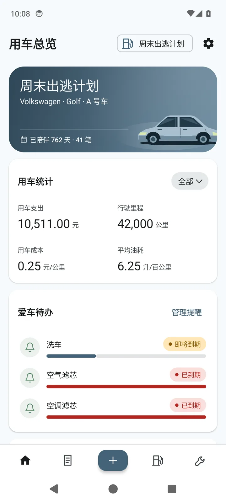
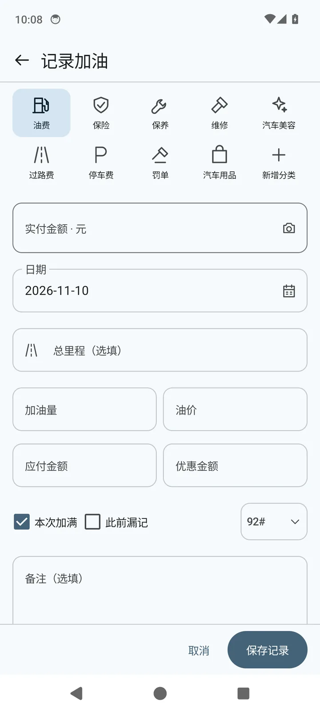
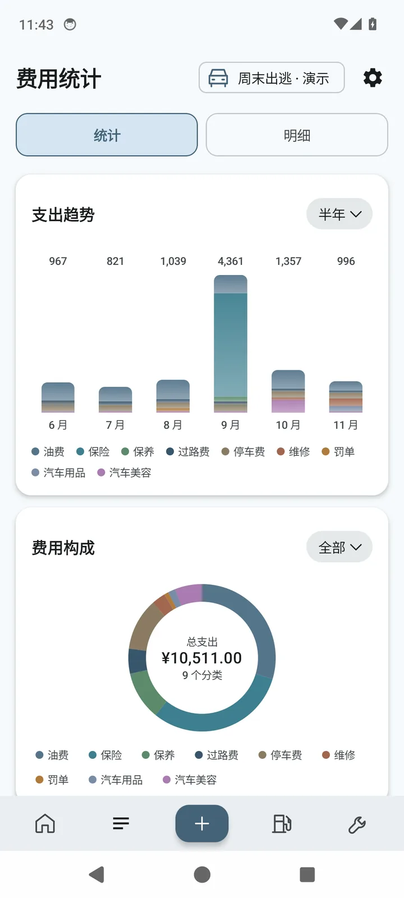
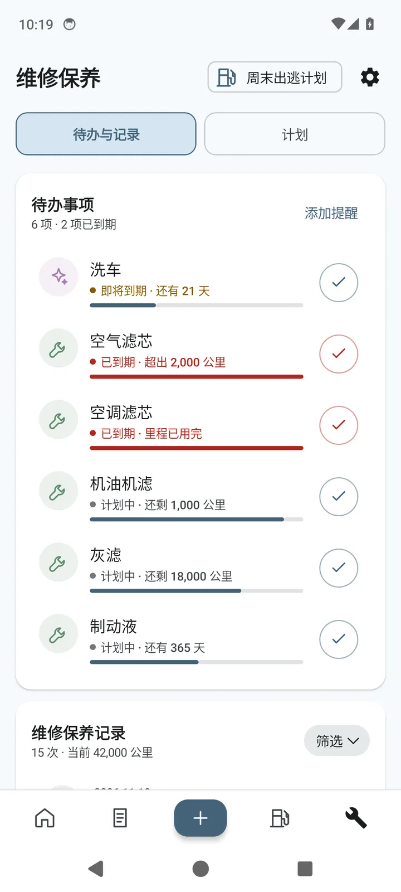

# 里程志 MileNote


**简体中文** · [English](README.en.md)

里程志（MileNote）是一款**开源、原生、本地优先的 Android 用车记账应用**，支持多车管理、日常费用记录、油耗与电耗分析、保养计划和用车成本统计。

应用无需注册账号，账本默认保存在手机本地，不依赖开发者服务器。需要在不同设备之间同步时，也可以连接自己的 WebDAV 存储服务，并可选开启加密上传（默认关闭）。

无论是加油、充电、停车，还是保险、维修与定期保养，都可以集中记录和管理，并通过统计图表了解车辆的使用情况与长期支出。

[**官网与下载**](https://selwiro.github.io/MileNoteAndroid/)  · [问题反馈](https://github.com/Selwiro/MileNoteAndroid/issues)

## 应用特点

- **本地优先，无需账号：** 账本默认只保存在设备上，没有订阅、广告或埋点统计。
- **燃油车、插电混动与纯电动车：** 分别提供油耗、油耗 + 电耗双口径、电耗分析，以及对应的保养方案。
- **多车独立管理：** 不同车辆的费用、能耗和保养记录相互独立，完整备份包含全部车辆。
- **分类与项目库可自定义：** 内置费用分类和保养项目都可以改名或隐藏（加油/保险/保养/维修 4 类不可删除）；隐藏只影响新建记录的候选，历史记录与统计不变。
- **数据方便迁移：** 支持从小熊油耗、钱迹导入记录，提供 CSV 导出、JSON 完整备份和可选的 WebDAV 同步（可加密上传）。

## 界面预览

以下截图来自 v0.27.0 的内置演示账本，所有数据均为合成示例。应用界面会随版本迭代调整，最新截图请查看[官方网站](https://selwiro.github.io/MileNoteAndroid/#screenshots)。

| 用车总览 | 记一笔 | 费用统计 | 维修保养 |
|:---:|:---:|:---:|:---:|
|  |  |  |  |

## 功能介绍

### 日常记账与多车管理

里程志支持添加任意数量的车辆，并为每辆车分别管理费用、能耗和保养记录。车辆可以设置名称、照片等信息，照片既可以从相册选择并自动压缩，也可以通过图片 URL 添加。

应用内置九类常用支出：

| 分类 | 常见记录 |
|---|---|
| 油费 | 加油、充电等能源支出 |
| 保险 | 交强险、商业保险 |
| 保养 | 常规保养及耗材更换 |
| 维修 | 故障检修、零部件维修 |
| 汽车美容 | 洗车、清洁、美容服务 |
| 过路费 | 高速公路、收费道路 |
| 停车费 | 临时停车、停车场费用 |
| 罚单 | 交通违法相关支出 |
| 汽车用品 | 车载设备、配件及用品 |

此外，还可以根据需要创建自定义分类。

记账页面将分类、金额、日期、里程和能源信息集中在一个页面，减少反复切换。已有记录支持搜索、筛选、按月查看，以及编辑和删除。

### 油耗与电耗分析

里程志会根据车辆的动力类型提供不同的能源记录和分析方式。

**燃油车：满箱法油耗**

以两次加满油之间的行驶里程和实际加油量计算油耗，避免将不完整的加油区间直接用于平均值计算。

- 第一次加满油只用于建立计算基准。
- 中途未加满的加油量会累计到下一次结算。
- 如果漏记了加油记录，可以标记漏记并重新建立基准。
- 提供综合平均油耗、每公里油费、油耗走势和加油明细。

**插电混动 / 增程：油耗 + 电耗双口径**

插电混动同时记录加油与充电：记一笔时在「燃油标号」下拉里选择「充电」，字段会切换为充电量 / 电价 / 充满。
能耗分析分别给出 **L/100km 和 kWh/100km** 两条口径，以及两流共同的「每公里能源费用」。
两个口径的分母都是总行驶里程（另一能源跑的里程也在里面），所以数值会低于亏电油耗，这是口径如此，不是漏算。

**纯电动车：满电法电耗**

纯电车型使用充电记录进行能耗分析，以 **kWh/100km** 展示平均电耗，并统计充电支出和每公里电费。

优先使用完整的满电区间计算能耗。如果所选范围内没有可用的满电区间，则根据累计充电量估算，并在界面中标明计算方式。

所有分析均基于已录入的数据，不会虚构缺失的记录。

### 保养计划

应用为不同动力类型提供预设保养方案：

- 燃油车：12 项默认保养项目。
- 插电混动 / 增程：13 项（燃油 12 项 + 三电诊断），首保含机油机滤与三电诊断。
- 纯电动车：6 项默认保养项目。

保养提醒同时参考时间和行驶里程，**任一条件达到设定值，即视为到期**。

保养计划表会显示上次完成情况、下次预计日期与里程，以及当前状态。完成保养并保存记录后，应用会自动安排下一轮计划。

到期项目在 App 内的待办列表中显示。需要使用系统日历提醒时，可以将单条计划导出为 `.ics` 文件。

### 费用统计

除了查看每笔记录，还可以通过统计页面了解一段时间内的用车支出。

主要包括：

- 累计支出、记录里程及每公里成本。
- 综合平均油耗或对应的能源消耗指标。
- 按月堆叠柱状图，展示各类费用的变化趋势。
- 费用构成环形图，比较不同分类的支出占比。
- 统计与明细双页签，以及自定义时间区间筛选。

每公里成本按照已录入支出与记录里程计算。车辆折旧、贷款利息等没有录入的费用，不会自动计入统计结果。

### 小票识别

加油后从系统照片选择器选一张小票或加油机屏幕照片即可识别。

应用使用 **Tesseract**（Tesseract4Android，内置 tessdata_fast 中文与英文模型）在设备端识别小票，尝试提取实付金额、加油量和日期；不申请相机权限，也不需要拍照。

加油机屏幕（七段数码管 LED/LCD 屏）另外走一个**内置几何解码器**：直接按七段位置读金额、升数、单价，不依赖 OCR 字形匹配，读出后仍按「金额 ≈ 升数 × 油价」做一致性校验。识别不出时，可在结果面板点「手动填写 / 修改读数」，用数字键盘或原文数字候选快速补录。

识别结果只会填入尚未填写的字段，不会覆盖已有内容。保存前需要自行核对，避免识别错误影响账本。

识别过程在本地完成，所用图片不会上传，也不会写入账本。

### 数据导入与导出

如果之前使用其他记账工具，不必从头录入全部数据。

目前支持：

| 来源 | 导入格式 |
|---|---|
| 小熊油耗 | XLS |
| 钱迹 | XLSX、JSON |
| 里程志完整备份 | JSON |

导入时可以调整字段映射、逐行预览和修改记录，并跳过识别出的重复数据。也可以通过 Android 系统分享功能，将文件发送到里程志导入。

导出提供两种方式：

- **费用 CSV：** 导出当前车辆的费用明细，包含 17 列字段。
- **完整 JSON 备份：** 保存全部车辆、账目、保养记录和相关数据。

完整备份可用于更换手机、恢复数据，也可以作为独立的本地存档。

### WebDAV 同步

WebDAV 是可选功能。未配置时，账本始终保存在本地。

可以连接坚果云、Nextcloud、群晖 NAS 或其他兼容 WebDAV 的存储服务。

同步支持手动触发，也可以在应用打开时自动执行一次，并在本地数据修改后进行防抖同步。

同步任务仅在应用前台运行，退出应用后不会继续后台同步。

WebDAV 连接密码使用 Android Keystore 与 AES-256-GCM 加密保存在设备上。Release 版本只允许 HTTPS 连接。

上传的账本可以选择加密（默认关闭）。在「设置 → WebDAV 同步」中开启「加密上传」并设置独立的加密密码（至少 8 个字符）后，远端保存的是 AES-256-GCM 密文，密钥由该密码经 PBKDF2-SHA256（600000 次迭代）派生；加密密码同样由 Android Keystore 保护，仅保存在本机，开发者无法获取。在另一台设备上输入同一密码即可解密并还原账本。

加密上传的文件与 Web 版「加密同步」使用同一种格式，可以互读：Web 版能读取 Android 加密的文件，Android 也能读取 Web 版加密或明文的文件。

**注意：** 未开启加密时，上传的账本仍是明文 JSON，传输安全依赖 HTTPS，建议使用可信任的服务并妥善设置访问权限。加密密码没有找回机制，忘记后将无法解密远端账本文件，请自行记牢。

### 其他功能

| 功能 | 说明 |
|---|---|
| 今日油价 | 按车辆燃油标号和定位城市显示参考油价及预计调价方向（非统一价省精确到市，匹配不到回退省级）；每天自动更新一次，也可手动刷新，抓取失败时保留上次价格 |
| 外观主题 | 里程蓝、森林绿、丁香紫、暖日橙、石墨灰五套主题，均支持浅色与深色模式 |
| 界面语言 | 简体中文、英文 |
| 显示单位 | 可设置货币、里程及油量单位，仅调整显示标识，不自动换算已有数值 |
| 桌面快捷方式 | 长按应用图标可快速记账或进入小票识别 |
| 系统集成 | 支持系统分享、SAF 文件选择和应用内检查更新 |
| 演示账本 | 内置两辆虚拟车辆及样例记录，退出演示后自动还原，不影响真实账本 |

今日油价仅在中文界面的燃油车型中提供。数据按「每日更新的公开油价数据集 → 免费 HTTPS 油价接口 → 本机缓存」顺序获取，仅供参考；成功获取后会缓存到本机，同一天内不重复请求，跨天自动更新，也可在卡片右上角手动刷新。

目前应用采用手机竖屏布局，尚未提供平板和横屏双栏界面。

## 下载与安装

当前发布版本为 **v0.37.0 Beta（versionCode 95）**。项目仍处于测试和持续完善阶段。

可通过以下渠道下载：

- [官方网站与下载页](https://selwiro.github.io/MileNoteAndroid/)
- [GitHub Releases](https://github.com/Selwiro/MileNoteAndroid/releases)

GitHub Releases 提供 APK、版本说明与 SHA-256 校验文件。官网也会从 GitHub Releases 读取最新版本、安装包大小及校验值。

### 系统要求

| 项目 | 要求 |
|---|---|
| Android 版本 | Android 8.0（API 26）及以上 |
| CPU 架构 | arm64-v8a / armeabi-v7a |
| APK 大小 | 约 23 MB |
| 安装方式 | 自签名 APK |

首次安装时，Android 可能要求允许浏览器或文件管理器「安装未知应用」。

安装后可以先体验内置演示账本，再添加车辆并开始正式记账。建议在使用初期导出一次完整 JSON 备份，熟悉备份与恢复流程。

**注意：** 使用不同签名密钥构建的 APK 无法互相覆盖安装。卸载应用、清除应用数据或更换设备前，请先备份账本。

## 数据与隐私

里程志不提供账号体系，也不在开发者服务器上建立用户账本数据库。

应用的数据处理遵循以下方式：

| 项目 | 处理方式 |
|---|---|
| 账本存储 | 保存在应用私有目录下的单文件 `version:2` JSON |
| 写入方式 | 原子写入，降低写入中断造成文件损坏的风险 |
| 车辆图片 | 以 dataURL 形式包含在账本中 |
| 文件导入 | 在设备端解析，不上传原始导入文件 |
| 小票 OCR | 在设备端识别，不上传或保存识别用图片 |
| WebDAV | 由用户自行配置，仅使用 HTTPS；默认上传明文 JSON，可开启加密上传（远端为 AES-256-GCM 密文） |
| 账号与统计 | 无账号、无订阅、无广告、无埋点统计 |

应用使用的权限只有网络和粗略定位。其中，粗略定位仅用于今日油价功能。

默认账本不会上传到开发者服务器；但使用今日油价、检查更新或自行配置 WebDAV 等联网功能时，应用仍会与相应外部服务通信。

油价抓取全部走 HTTPS，只发送省份名称，不发送账本、图片或定位坐标。

### 数据备份

账本保存在应用私有目录，卸载应用或清除应用数据可能使其丢失。

因此，建议定期导出完整 JSON 备份，并保存到手机以外的位置。

完整备份包含车辆图片和账本数据，请像保管其他个人文件一样妥善保管。

## 已知限制

里程志仍在持续开发，目前存在以下限制：

- **多设备使用：** 不支持账号式实时同步，WebDAV 仅在应用前台运行。
- **保养提醒：** 到期项目只在应用内提示，不会发送系统通知；可以手动导出日历文件。
- **屏幕适配：** 当前锁定竖屏，尚未提供平板及横屏双栏布局。
- **纯电车型：** 暂不支持充电小票 OCR、电池健康分析或续航估算。
- **今日油价：** 价格及调价方向仅供参考，实际以官方公布信息和加油站价格为准。
- **成本统计：** 仅根据已记录的数据计算，不自动计入折旧、贷款利息等其他成本。
- **数据同步安全：** WebDAV 未开启加密时远端保存明文 JSON；开启加密后为 AES-256-GCM 密文，加密密码仅存本机且无法找回。无论是否加密，都需由用户自行确保服务器安全。
- **APK 签名：** 不同签名的安装包不能直接覆盖安装。

## 开发计划

项目目前处于 `0.x` Beta 阶段，持续进行问题修复、功能完善和使用体验优化。

**已确定的版本计划：**

- **Beta（0.x）：** 持续迭代与测试。
- **1.0.0：** 首个正式版本。
- **正式版之后：** 按照语义化版本规则（SemVer）管理版本号。

其他功能需求可以通过 [GitHub Issues](https://github.com/Selwiro/MileNoteAndroid/issues) 提交和讨论。尚未明确安排的功能不代表已经进入开发计划。

具体更新内容以 [Releases](https://github.com/Selwiro/MileNoteAndroid/releases) 为准。

---

## 开发者文档

以下内容面向希望自行构建、研究代码或参与开发的用户。

### 技术栈

里程志使用 Kotlin 开发，采用 Android 原生技术栈。

| 技术 | 用途 |
|---|---|
| Kotlin | 主要开发语言 |
| Jetpack Compose | 声明式 UI |
| Material 3 Expressive | 界面组件与主题 |
| Compose Navigation | 页面导航 |
| DataStore | 应用设置持久化 |
| JSON Snapshot | 账本数据存储 |
| Tesseract4Android | 设备端中英文文字识别（Apache-2.0，内置 tessdata_fast 模型） |
| OkHttp | WebDAV 网络通信 |
| Android Keystore | 连接密码安全存储 |

架构采用单 Activity + Compose Navigation。业务计算与数据模型主要放在独立的纯 Kotlin 领域模块中，便于测试和复用。

### 项目结构

```text
MileNoteAndroid/
├── app/                  # Android 应用模块
│   └── src/test/         # App 单元测试
├── domain/               # 纯 Kotlin 领域模块
│   └── src/test/         # 领域单元测试
├── gradle/               # Gradle Wrapper 配置
├── build.sh              # Release 构建与归档
├── dev-gradle.sh         # 开发构建辅助脚本
├── AGENTS.md             # 项目开发约定
├── README.md             # 中文说明
└── README.en.md          # English README
```

各模块主要职责如下：

- **`app/`：** Compose 界面、ViewModel、账本读写、OCR、文件导入导出、WebDAV 和 Android 平台集成。
- **`domain/`：** 数据模型、满箱法与满电法、保养计划、统计计算、备份合并及导入解析等领域逻辑。
- **`app/src/test/`：** App 层单元测试。
- **`domain/src/test/`：** 领域层 JVM 单元测试。

### 构建环境

项目需要 JDK 17 或更高版本，以及 Android SDK Platform 37 和 Build-Tools 37.0.0。

Gradle 由仓库中的 Wrapper 提供，首次构建时自动下载，无需单独安装全局 Gradle。

以下是目前通过构建与测试的版本组合：

| 组件 | 版本 |
|---|---|
| Gradle | 9.6.0 |
| Android Gradle Plugin | 9.5.0 |
| Kotlin | 2.4.21 |
| Compose BOM | 2026.09.00 |
| Material 3 | 1.5.0-beta02 |
| compileSdk / targetSdk | 37 |
| minSdk | 26 |

建议优先使用以上组合，升级依赖前先验证构建和测试结果。

### 获取源码

```bash
git clone https://github.com/Selwiro/MileNoteAndroid.git
cd MileNoteAndroid
```

可以直接使用 Android Studio 打开仓库根目录。

命令行构建时，通过 `ANDROID_HOME` 指定 Android SDK 路径，或使用 Android Studio 自动生成 `local.properties`。

### 构建 Debug APK

```bash
./gradlew :app:assembleDebug
```

构建结果位于：

```text
app/build/outputs/apk/debug/app-debug.apk
```

### 运行测试

```bash
./gradlew :domain:test :app:testDebugUnitTest
```

当前包含 **286 项领域层单元测试**和 **157 项 App 层单元测试**。

### 构建 Release APK

```bash
./build.sh release
```

脚本会执行包含 R8 的 Release 构建，并将产物归档到仓库的 `dist/` 目录，同时生成 `.sha256` 校验文件。

可以通过环境变量修改归档位置：

```bash
MILENOTE_OUT_DIR=/path/to/output ./build.sh release
```

### 配置构建镜像

中国大陆网络环境下，可以使用仓库提供的阿里云镜像配置：

```bash
export MILENOTE_ALIYUN=1
```

如果 Gradle Wrapper 发行包下载缓慢，也可以修改 `gradle/wrapper/gradle-wrapper.properties` 中的 `distributionUrl`，替换为可用的镜像地址，例如：

```text
https://mirrors.cloud.tencent.com/gradle/gradle-9.6.0-bin.zip
```

使用第三方镜像时，请自行确认文件来源与完整性。

### Release 签名

Release 签名是可选的。没有配置签名密钥时，仍然可以完成构建，但产出的是 `app-release-unsigned.apk`。

如需签名，请自行准备密钥，并在以下路径配置：

```text
keystore/keystore.properties
```

配置内容包括：

```properties
storePassword=...
keyAlias=...
keyPassword=...
```

也可以通过环境变量提供密码：

- `MILENOTE_STORE_PASSWORD`
- `MILENOTE_KEY_PASSWORD`

签名密钥、密码及相关敏感文件不得提交到 Git 仓库。

### 版本与发布

项目在 `main` 分支持续迭代，使用 `vX.Y.Z` 格式的 Git Tag 标记发布版本。

每个发布 Tag 对应 GitHub Release，包含 APK 与 SHA-256 校验文件。

本仓库的 Android 公开发布历史从 **v0.27.0（2026 年 11 月 6 日）** 开始。

版本说明和安装文件统一维护在 [GitHub Releases](https://github.com/Selwiro/MileNoteAndroid/releases)。

## 反馈与贡献

欢迎通过 GitHub Issues 反馈 Bug、提出建议，或通过 Pull Request 参与开发。

### 提交问题

请在 [Issues](https://github.com/Selwiro/MileNoteAndroid/issues) 中描述问题。Bug 报告建议包含：

- 应用版本号（设置 → 关于）。
- 手机型号及 Android 版本。
- 复现步骤与实际表现。
- 必要的截图或错误信息。

请注意保护隐私，不要上传包含真实个人信息的账本或小票。

### 提交代码

对于较大的功能修改，建议先创建 Issue 讨论实现方案。

提交 Pull Request 前，请至少运行：

```bash
./gradlew :domain:test :app:testDebugUnitTest
./gradlew :app:assembleDebug
```

项目的开发约定详见 [AGENTS.md](AGENTS.md)，其中包含账本格式、权限、测试和发布等规则。

提交信息采用以下格式：

```text
type(范围): 摘要
```

所有演示和测试数据应使用合成数据。请勿提交真实账本、小票、签名密钥、密码或构建产物。

## 致谢

这个应用能跑起来，靠的是很多开源项目、公开数据与参考资料。感谢所有维护者和贡献者。

### 核心运行库

| 项目 | 许可证 | 用途 |
|---|---|---|
| [Kotlin](https://kotlinlang.org/) / [kotlinx.coroutines](https://github.com/Kotlin/kotlinx.coroutines) / [kotlinx.serialization](https://github.com/Kotlin/kotlinx.serialization) | Apache-2.0 | 开发语言、协程与 JSON 序列化 |
| [AndroidX](https://developer.android.com/jetpack/androidx)（Core / Activity / Lifecycle / Navigation / DataStore / SplashScreen） | Apache-2.0 | 应用基础能力、页面导航、设置持久化、启动画面 |
| [Jetpack Compose](https://developer.android.com/jetpack/compose)（UI / Foundation / Material 3） | Apache-2.0 | 声明式界面与 Material 3 Expressive 主题 |
| [Material Icons](https://fonts.google.com/icons) | Apache-2.0 | 界面图标 |
| [Coil 3](https://coil-kt.github.io/coil/) | Apache-2.0 | 车辆图片等图片加载与缓存 |
| [OkHttp](https://square.github.io/okhttp/) / [Okio](https://square.github.io/okio/) | Apache-2.0 | 网络请求（WebDAV、更新检查、油价） |

### OCR 与文字识别

| 项目 | 许可证 | 用途 |
|---|---|---|
| [Tesseract4Android](https://github.com/adaptech-cz/Tesseract4Android) | Apache-2.0 | Android 上的 Tesseract 封装（JNI） |
| [Tesseract OCR](https://github.com/tesseract-ocr/tesseract) | Apache-2.0 | 中英文文字识别引擎 |
| [Leptonica](https://github.com/DanBloomberg/leptonica) | BSD-2-Clause | 图像处理（Tesseract 依赖） |
| libjpeg / libpng | IJG 许可证 / libpng 许可证 | 图片编解码（随 Tesseract4Android 内置） |
| [tessdata_fast](https://github.com/tesseract-ocr/tessdata_fast) | Apache-2.0 | 内置 `chi_sim` / `eng` 语言模型 |

七段数码管（加油机屏幕）的几何解码是自研代码，按公开的 a–g 七段排布实现，没有使用第三方 OCR 模型或代码。

### 开发、构建与测试

| 项目 | 许可证 | 用途 |
|---|---|---|
| [Gradle](https://gradle.org/) / [Android Gradle Plugin](https://developer.android.com/build) | Apache-2.0 | 构建系统 |
| Kotlin Gradle Plugin / Compose Compiler / Serialization Plugin | Apache-2.0 | 编译与代码生成 |
| [OpenJDK](https://openjdk.org/) | GPLv2 + Classpath Exception | 构建与运行 JDK |
| [JUnit 4](https://junit.org/junit4/) | Eclipse Public License 1.0 | 单元测试 |
| [kotlinx-coroutines-test](https://github.com/Kotlin/kotlinx.coroutines) | Apache-2.0 | 协程测试 |
| [Android SDK / Build Tools](https://developer.android.com/studio) | Android SDK 许可（非开源） | Android 平台与构建工具 |

### 数据与信息服务

| 来源 | 许可证/性质 | 用途 |
|---|---|---|
| [fanzbus/oil-price](https://github.com/fanzbus/oil-price) | MIT | 31 省油价、10 个非统一价省 124 城城市级价格、调价方向预测（公开静态 JSON） |
| [wangzhaolong616-byte/oil-price](https://github.com/wangzhaolong616-byte/oil-price) | MIT | 省级油价 + 调价方向的备用数据集 |
| [ZhangHowie/oilpulse-cn](https://github.com/ZhangHowie/oilpulse-cn) | MIT | 省级油价快照的备用数据集 |
| [jsDelivr](https://www.jsdelivr.com/) | CDN 服务 | 分发上述公开静态 JSON（请求不携带任何参数） |
| vvhan / oioweb / tenapi 公共接口 | 免费公开接口（条款以各站为准） | 油价兜底查询（仅发送省份名） |
| 各数据集的上游公开油价站点（如汽油价格网、东方财富等） | 公开数据 | 数据集的价格来源；应用只读取价格数字与调价方向 |
| [国家发展改革委](https://www.ndrc.gov.cn/) 成品油定价机制与调价公告 | 官方公开信息 | 调价窗口与涨跌规则的参考（最终以官方公告为准） |
| Android 系统 Geocoder | 系统服务 | 把粗略坐标换成省市名（不保存坐标） |

### 参考与规范

- [Apache License 2.0](https://www.apache.org/licenses/LICENSE-2.0) 官方文本。
- [Developer Certificate of Origin (DCO) 1.1](https://developercertificate.org/)：外部贡献的签署约定。
- [Material Design](https://m3.material.io/) / Material 3 Expressive 设计指南：界面与动效的参考。
- [Android 开发者文档](https://developer.android.com/docs)：Compose、DataStore、网络与平台能力的使用参考。

### 产品与设计参考

以下应用在功能设计与页面布局上提供了参考（仅参考信息架构与交互思路，未使用其代码、图标或素材）：

- [小熊油耗](https://www.xiaoxiongyouhao.com/app_download)：油耗统计与车辆记账的信息架构参考。
- [CarNote](https://github.com/Kaiyuan/CarNote)：车辆记录类应用的结构与记录组织方式参考。
- [iCar · 车辆记录助手](https://apps.apple.com/cn/app/icar-%E8%BD%A6%E8%BE%86%E8%AE%B0%E5%BD%95%E5%8A%A9%E6%89%8B-%E8%AE%B0%E6%B2%B9%E8%80%97-%E8%AE%B0%E4%BF%9D%E5%85%BB-%E8%AE%B0%E6%94%AF%E5%87%BA-%E4%BF%9D%E5%85%BB%E8%AE%A1%E6%97%B6/id6532600650)：iOS 端车辆记录、油耗与保养功能的交互参考。

### 完整依赖清单

App 内「设置 → 关于 → 开源许可」列出随 APK 分发的全部运行期依赖（当前 182 项）及其许可证全文；本页只列直接使用的项目与数据来源。第三方组件清单见 [app/src/main/assets/licenses/third-party-notices.txt](app/src/main/assets/licenses/third-party-notices.txt)。

## 许可与贡献

- **源码许可**：本仓库源代码以 [Apache License 2.0](LICENSE) 授权，版权行见 [NOTICE](NOTICE)。你可以阅读、修改、自行构建并再分发（包括免费再分发），只需保留版权与许可声明，并遵守 Apache-2.0 的条款。
- **外部贡献（DCO）**：欢迎 Pull Request，但提交需带 Developer Certificate of Origin 签署（`git commit -s`，即提交信息末尾带 `Signed-off-by: 你的名字 <你的邮箱>`），表示你有权按 Apache-2.0 提交该贡献；提交前请先开 Issue 讨论，并跑通单测与编译。

## 相关链接

- [官方网站与下载](https://selwiro.github.io/MileNoteAndroid/)
- [English Site](https://selwiro.github.io/MileNoteAndroid/en/)
- [GitHub Releases](https://github.com/Selwiro/MileNoteAndroid/releases)
- [Issues / 问题反馈](https://github.com/Selwiro/MileNoteAndroid/issues)

网站页面与截图资源维护在 `gh-pages` 分支，Android 应用源码主要维护在 `main` 分支。

## 赞助

给作者喂点 token。


